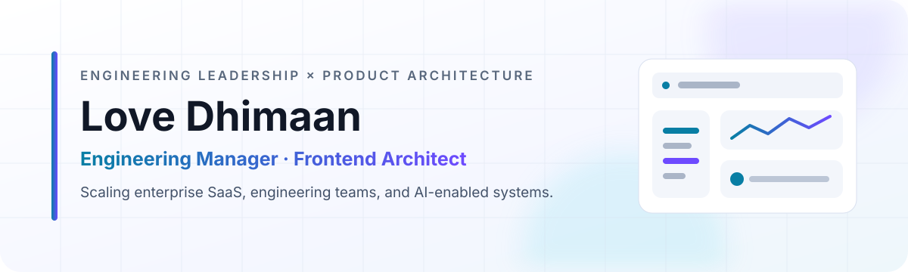

<picture>
  <source media="(prefers-color-scheme: dark)" srcset="./assets/profile-banner-dark.svg">
  <source media="(prefers-color-scheme: light)" srcset="./assets/profile-banner-light.svg">
  
</picture>

<p align="center">
  I lead engineering teams and remain hands-on with the architecture and code<br>
  behind scalable enterprise products.
</p>

<p align="center">
  <a href="https://thelovedhimaan.com"></a>&nbsp;
  <a href="https://www.linkedin.com/in/thelovedhimaan"></a>&nbsp;
  <a href="mailto:thelovedhimaan@gmail.com"></a>
</p>

## Impact

| **17-person engineering team** | **30-45% faster dashboards** | **60% faster onboarding** |
|:---:|:---:|:---:|
| Frontend, backend, mobile, and AI | Interfaces handling 10K-50K+ records | Enterprise customer workflows |

## How I work

<table>
  <tr>
    <td width="50%" valign="top">
      <h3>01 · Architect for scale</h3>
      <p>Reusable component systems, dependable data flows, design systems, and maintainable frontend foundations.</p>
    </td>
    <td width="50%" valign="top">
      <h3>02 · Measure performance</h3>
      <p>Virtualization, pagination, code splitting, rendering analysis, and API optimization backed by evidence.</p>
    </td>
  </tr>
  <tr>
    <td width="50%" valign="top">
      <h3>03 · Lead through delivery</h3>
      <p>Technical direction, hiring, mentoring, reviews, release planning, and direct enterprise customer work.</p>
    </td>
    <td width="50%" valign="top">
      <h3>04 · Apply AI deliberately</h3>
      <p>LLM and RAG workflows designed with evaluation, observability, citations, and production guardrails.</p>
    </td>
  </tr>
</table>

## Featured work

<table>
  <tr>
    <td valign="top">
      <h3><a href="https://github.com/thelovedhimaan/thelovedhimaan-portfolio">Engineering portfolio</a></h3>
      <p>A Next.js portfolio focused on engineering leadership, frontend architecture, measurable performance work, and hands-on product delivery.</p>
      <p><code>Next.js</code> <code>React</code> <code>TypeScript</code> <code>MDX</code> <code>Sass</code></p>
      <p><a href="https://thelovedhimaan.com"></a></p>
    </td>
  </tr>
  <tr>
    <td valign="top">
      <h3><a href="https://github.com/thelovedhimaan/color-pallet">Color Palette Studio</a></h3>
      <p>A completed, local-first color workspace for building palettes, checking WCAG contrast, simulating color-vision deficiencies, saving versions, sharing palettes, and exporting design tokens.</p>
      <p><code>React 19</code> <code>TypeScript</code> <code>Vite</code> <code>Vitest</code> <code>WCAG</code></p>
      <p><a href="https://color-pallet-drab.vercel.app"></a></p>
    </td>
  </tr>
</table>

## Building next

**01 — Analytics workspace**

High-performance exploration of large datasets, with documented architecture
decisions and performance evidence.

**02 — Onboarding pipeline**

Resilient CSV mapping and validation, background processing, progress tracking,
and actionable error recovery.

**03 — AI incident intelligence**

RAG-assisted root-cause analysis with source citations, evaluation,
observability, and guardrails.

Every project will ship with tests, CI checks, technical documentation,
measurable results, and a live demonstration.

## Core toolkit

```text
PRODUCT       React · Next.js · TypeScript · Node.js · Express
DATA          PostgreSQL · MongoDB · REST APIs
SYSTEMS       Design systems · Performance · Docker · CI/CD · AWS
AI            LLM integration · RAG · Evaluation · Observability
LEADERSHIP    Architecture · Hiring · Mentoring · Delivery · Releases
```

---

<p align="center">
  <strong>Let's build software that survives real users, real data, and real scale.</strong><br><br>
  Open to Engineering Manager, Frontend Architect, Technical Lead,<br>
  and hands-on product engineering opportunities.
</p>
