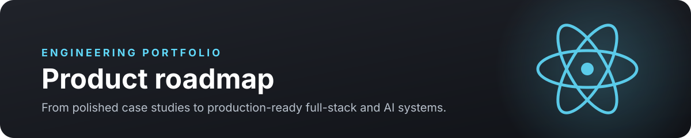

 

# Roadmap

This roadmap tracks the portfolio from a polished personal site into a body of
evidence for engineering leadership, frontend architecture, full-stack delivery,
and applied AI work. Priorities may move as projects produce stronger outcomes.

## Status guide

| Marker | Meaning |
| :---: | :--- |
| ✅ | Complete |
| 🚧 | In progress |
| ⏭️ | Planned next |
| 💡 | Exploring |

## Now — Portfolio foundation

> Turn the current site into a clear, credible account of shipped work and
> measurable engineering impact.

- [x] Establish the Next.js 16, React 19, TypeScript, and Once UI foundation
- [x] Add responsive home, about, work, blog, and gallery routes
- [x] Configure MDX content, metadata, sitemap, RSS, and social previews
- [x] Refresh repository documentation and visual identity
- [ ] Replace remaining template content with original portfolio material 🚧
- [ ] Publish the first outcome-focused engineering case study 🚧
- [ ] Add project screenshots, architecture diagrams, and decision records
- [ ] Review accessibility, keyboard navigation, contrast, and responsive behavior

### Definition of done

- Every public page contains production-ready content
- Each featured project explains the problem, constraints, decisions, and results
- Core pages pass accessibility and responsive-layout checks
- Lighthouse results are recorded for desktop and mobile

## Next — Production quality

> Make quality visible through automation, testing, and performance evidence.

- [ ] Add continuous integration for formatting, type checking, and builds ⏭️
- [ ] Add focused component and integration tests for critical interactions
- [ ] Add automated accessibility checks
- [ ] Capture Core Web Vitals and bundle-size baselines
- [ ] Add deployment previews for pull requests
- [ ] Document environment variables, deployment, and release checks
- [ ] Add graceful loading, empty, and error states across dynamic pages

### Target evidence

| Area | Evidence to publish |
| :--- | :--- |
| Reliability | CI checks and repeatable production builds |
| Accessibility | Automated audit plus manual keyboard review |
| Performance | Before-and-after metrics and bundle analysis |
| Delivery | Preview deployments and documented release workflow |

## Then — Flagship case studies

> Demonstrate architectural judgment with complete, measurable projects.

### Enterprise analytics workspace

- [ ] Build high-volume data exploration with sorting, filtering, and pagination
- [ ] Compare virtualization strategies for 10K–50K+ records
- [ ] Document rendering, caching, and API design decisions
- [ ] Publish performance traces and before-and-after measurements

### Customer onboarding pipeline

- [ ] Build resilient CSV mapping and validation
- [ ] Add background processing, progress tracking, and retry behavior
- [ ] Design actionable error recovery for customer operations teams
- [ ] Measure throughput, failure rates, and time saved

### AI incident intelligence

- [ ] Build citation-backed incident search and root-cause assistance
- [ ] Add retrieval evaluation, observability, and guardrails
- [ ] Show confidence, sources, and limitations in the interface
- [ ] Publish an evaluation set and quality measurements

## Later — Platform expansion

- [ ] Add a searchable project and article index 💡
- [ ] Add project filters by discipline, technology, and outcome
- [ ] Create interactive architecture walkthroughs
- [ ] Publish reusable engineering templates and decision records
- [ ] Add an experiments area for small React, performance, and AI prototypes
- [ ] Evaluate multilingual content support

## Ongoing principles

- Prefer measured outcomes over feature lists
- Explain tradeoffs and constraints alongside implementation choices
- Keep interactions accessible and useful without animation
- Use progressive enhancement and resilient defaults
- Treat performance, observability, and documentation as product features
- Keep case studies honest about ownership, collaboration, and limitations

---

**Have feedback or want to collaborate?**

[Portfolio](https://thelovedhimaan.com) ·
[LinkedIn](https://www.linkedin.com/in/thelovedhimaan) ·
[GitHub](https://github.com/thelovedhimaan)

